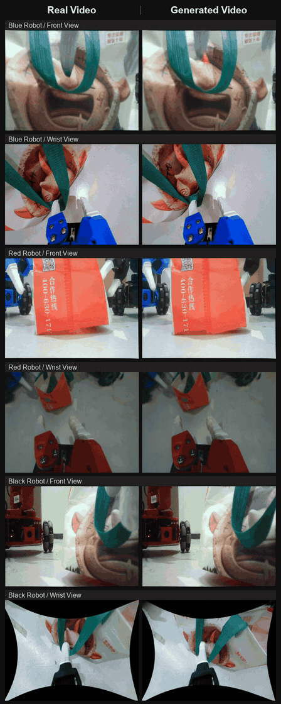

# WorldDreamer-V5-Lite · RoboCasa

[Project page](https://worldagents-c.github.io/worlddreamer-v5-project/)

## Model

**WorldDreamer-V5-Lite is the first open-source unified world-action model for
one-to-many multi-robot collaborative control**, as introduced on our
[project page](https://worldagents-c.github.io/worlddreamer-v5-project/).
A single model coordinates multiple robot agents toward a shared language goal
while predicting future observations from their different camera views.
Demonstrations span simulation and real robots, including coordinated camera
operation, object placement, retrieval, and handover.

The architecture combines a vision-language backbone, a video expert with a
causal VAE, a spatial triplane representation, and an action decoder. Language,
images, robot states, and camera geometry condition visual predictions and
robot actions.

This repository provides the **RoboCasa inference and evaluation runtime**,
using observed-video features to predict robot actions. Its `lite` profile uses left, right, and wrist cameras, four 14-dimensional
state observations, and a 36-layer action decoder. Each inference produces
16 steps of 18-dimensional action representations and a separate control-mode
signal. A feedback-based adapter decodes these representations into physical
actions and the simulator's 12-dimensional commands. Camera intrinsics and
extrinsics come from the simulator.

## Future multi-view predictions

Real observations are on the left of each comparison; generated future views
are on the right. These six-second excerpts play at their original speed.

| Three real robots · object retrieval | Four simulated robots · camera operation |
| :---: | :---: |
|  |  |

## Installation

Use Linux, an NVIDIA GPU with a CUDA-compatible driver, **Python 3.10**, and
[uv](https://docs.astral.sh/uv/getting-started/installation/). Run the following
commands from this repository's root.

### Model environment

```bash
uv python install 3.10
bash scripts/install_model.sh
```

The script creates `.venv-model` and installs the following model dependencies:

| Dependency | Version |
| --- | --- |
| PyTorch / torchvision | 2.9.0 / 0.24.0 |
| Transformers | 4.57.1 |
| Diffusers | 0.39.0.dev0 · source commit `fc77592427a3ad802ff4924ede31541d809097a2` |
| Accelerate | 1.11.0 |
| safetensors | 0.8.0 |
| NumPy | 1.26.4 |

Diffusers is installed directly from its pinned
[public source commit](https://github.com/huggingface/diffusers/commit/fc77592427a3ad802ff4924ede31541d809097a2)
through the `model` dependency group. The equivalent installation commands are:

```bash
uv venv --python 3.10 .venv-model
uv pip install --python .venv-model/bin/python -e '.[model]'
uv pip check --python .venv-model/bin/python
```

Place the RoboCasa model package in a directory containing
`model.safetensors`, `model_config.json`, `checkpoint.json`, `normalize.json`,
and `assets/`.

### Text environment

Text feature generation runs in a separate environment with Transformers
5.5.4. Prepare the matching text assets with this directory structure:

```text
text-assets/
  tokenizer/tokenizer.json
  tokenizer/tokenizer_config.json
  text_encoder/config.json
  text_encoder/model.safetensors
```

The worker verifies these files against `configs/text_assets.json` before
encoding. Install its dependencies:

```bash
uv venv --python 3.10 .venv-text
uv pip install --python .venv-text/bin/python -r requirements-text.txt
uv pip check --python .venv-text/bin/python
```

### Simulator environment

Install RoboCasa365, robosuite, and the simulation assets following the
[official installation guide](https://robocasa.ai/docs/introduction/installation.html).
To use uv with local checkouts of the two repositories:

```bash
uv venv --python 3.10 .venv-sim
uv pip install --python .venv-sim/bin/python \
  -e /path/to/robosuite -e /path/to/robocasa
uv pip check --python .venv-sim/bin/python
.venv-sim/bin/python -m robocasa.scripts.setup_macros
.venv-sim/bin/python -m robocasa.scripts.download_kitchen_assets
```

Use RoboCasa365 1.0.1, robosuite 1.5.2, and MuJoCo 3.3.1, with
`robocasa.wrappers.gym_wrapper.RoboCasaGymEnv` available.
Skip the asset download if the kitchen assets are already installed.
The simulator environment stays separate from the model environment and uses
RoboCasa's own dependency versions. Configure CUDA/EGL for headless rendering.

## Run an evaluation

Set the asset paths below to your local directories. Use the same absolute
text-cache path for the text worker and the policy service.

**1. Start the text worker in one terminal.**

```bash
PYTHONPATH=src .venv-text/bin/python -m robocasa_runtime.text_cache \
  --assets /path/to/text-assets \
  --integrity configs/text_assets.json \
  --queue /path/to/text-cache
```

Wait for `Text cache worker ready`. Keep this process running: the policy
requests features for each exact task instruction, and the worker writes the
cache automatically. The cache directory can initially be empty.

**2. Start the model service in another terminal.**

```bash
MODEL_PYTHON=.venv-model/bin/python GPU=0 \
MODEL_PATH=/path/to/world_dreamer_v5_robocasa \
TEXT_CACHE=/path/to/text-cache \
  bash scripts/serve.sh --port 18120 --log-dir outputs/policy
```

**3. After `POLICY_READY` appears, run one simulation episode.**

```bash
MUJOCO_GL=egl PYOPENGL_PLATFORM=egl \
SIM_PYTHON=.venv-sim/bin/python \
  bash scripts/evaluate.sh \
    --tasks CloseToasterOvenDoor --episodes 1 \
    --split pretrain --environment-seed 7 --seed 800107 \
    --horizon 450 --execute-steps 16 \
    --port 18120 --output outputs/check-001 --video
```

The run writes `summary.json` and per-episode `result.json`, `actions.npz`,
`inference.jsonl`, and `rollout.mp4`. Check the episode status, executed step
count, and success flag in `result.json`; the video shows the resulting rollout.
Use a new output directory for each run.

To evaluate all 50 configured tasks on the default pretrain split:

```bash
MUJOCO_GL=egl PYOPENGL_PLATFORM=egl \
SIM_PYTHON=.venv-sim/bin/python \
  bash scripts/evaluate.sh --tasks all --episodes 50 \
    --split pretrain --port 18120 --output outputs/pretrain50 --video
```

Task names and default episode horizons are listed in
[`configs/task_sets.yaml`](configs/task_sets.yaml).

For an offline inference check, replay an `initial_observation.npz` saved by a
simulation episode. Stop the model service to free its GPU memory and keep the
text worker running:

```bash
PYTHONPATH=src .venv-model/bin/python -m robocasa_runtime.replay \
  --model-path /path/to/world_dreamer_v5_robocasa \
  --text-cache /path/to/text-cache \
  --observation /path/to/initial_observation.npz \
  --output outputs/replay-001
```
